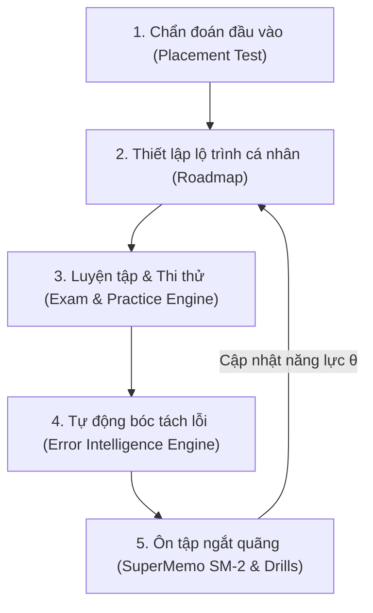
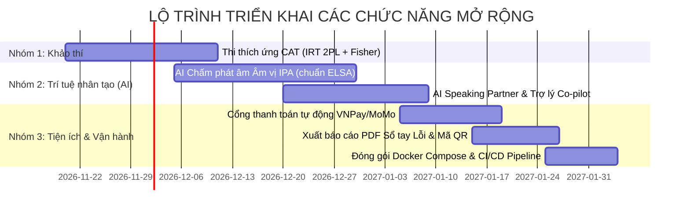

# TỔNG HỢP CHỨC NĂNG HỆ THỐNG ORBILINGO & LỘ TRÌNH PHÁT TRIỂN CHUYÊN SÂU
> **Đề tài:** Xây dựng nền tảng luyện thi tiếng Anh TOEIC–VSTEP thích ứng theo năng lực, tích hợp phân tích lỗi và lộ trình ôn tập cá nhân hóa.  
> **Cấp độ:** Đồ án chuyên ngành / Đồ án tốt nghiệp (DACN)  
> **Kiến trúc hệ thống:** Turborepo Monorepo (React 18 + Vite + Tailwind / Node.js + Express + Prisma ORM + PostgreSQL / Packages Shared)

---

## I. TỔNG QUAN KIẾN TRÚC & QUY MÔ HỆ THỐNG HIỆN TẠI

Hệ thống **OrbiLingo** được xây dựng nhằm giải quyết bài toán cốt lõi của người luyện thi: **"Làm nhiều đề nhưng vẫn lặp lại lỗi sai cũ do thiếu cơ chế chẩn đoán và ôn tập ngắt quãng khoa học."**

### 1. Vòng học tập thích ứng 5 bước (Adaptive Learning Loop)

### 2. Thống kê khối lượng mã nguồn đã triển khai (Dữ liệu thật)
* **Cơ sở dữ liệu:** **59 bảng quan hệ** chuẩn hóa 3NF, **171 chỉ mục (indexes/constraints/views)**.
* **Ngân hàng dữ liệu:** **21.009 câu hỏi** có tham số IRT, **1.390 bài đọc/nghe (passages)**, **29 đề thi chuẩn**, **454 bài học** (15 bài đã gắn video/audio), **5.986 từ vựng** (17 bộ), **48 chủ điểm ngữ pháp**.
* **Backend:** **255 RESTful API routes** chia theo 8 module nghiệp vụ (`auth`, `catalog`, `learner`, `teacher`, `head`, `admin`, `cms`, `import`).
* **Frontend:** **107 màn hình** hoàn thiện cho 5 vai trò; **5 engines dùng chung** (`ExamRunner`, `PracticeEngine`, `LessonEngine`, `CrudEditor`, `VocabFlashcard`).
* **Shared Packages:** Thư viện thuật toán chung (Quy đổi điểm ETS/VSTEP, thuật toán Spaced Repetition SM-2, Heuristic phân loại lỗi sai, GraphRAG trích xuất tri thức mạo từ).

---

## II. BẢNG THỐNG KÊ CHI TIẾT TỪNG CHỨC NĂNG THEO PHÂN HỆ

> **Quy ước trạng thái:**  
> 🟢 **ĐÃ HOÀN THÀNH (100%):** Đã chạy thực tế với dữ liệu thật từ database, đầy đủ cả UI và API.  
> 🟡 **ĐANG PHÁT TRIỂN (50%):** Đã có khung cốt lõi hoặc giao diện, đang hoàn thiện tích hợp sâu.  
> 🔵 **DỰ ĐỊNH LÀM (0%):** Kế hoạch nghiên cứu và mở rộng nâng cao trong các giai đoạn tiếp theo.

---

### 1. Phân hệ Khách vãng lai (Guest & Public Portal)
| STT | Tên chức năng | Mô tả chi tiết chức năng | Trạng thái | CSDL & Kỹ thuật liên quan |
| :---: | :--- | :--- | :---: | :--- |
| 1.1 | **Trang chủ & Landing Page** | Giới thiệu hệ thống, triết lý 5 bước, bảng so sánh tính năng, testimonial học viên, FAQ động. | 🟢 Đã xong | `posts`, `faqs`, `testimonials`, CMS API |
| 1.2 | **Cẩm nang & Cấu trúc Đề thi** | Trang tra cứu chi tiết cấu trúc 7 Part TOEIC và 4 Kỹ năng VSTEP định dạng chuẩn quốc tế. | 🟢 Đã xong | `posts.kind = EXAM_GUIDE`, SSG/CSR |
| 1.3 | **Công cụ Quy đổi Điểm Đa Khung** | Bảng tương đương trực quan giữa TOEIC ↔ VSTEP ↔ CEFR (A1–C2) ↔ IELTS. | 🟢 Đã xong | `packages/shared/constants/conversion` |
| 1.4 | **Kho Đề thi Thử & Thư viện Mẫu** | Cho phép khách xem danh mục đề thi, khóa học, làm thử bài tập mẫu không cần đăng nhập. | 🟢 Đã xong | `mock_tests`, `questions`, Public Catalog API |
| 1.5 | **Thi thử nhanh (Micro-Try)** | Cho khách làm thử 5–7 câu nhanh kiểm tra trình độ cơ bản. | 🟡 Đang làm (50%) | Cần nâng cấp thuật toán chẩn đoán tự thích ứng |
| 1.6 | **Video Demo Trải nghiệm Trực quan** | Khách xem thử bài giảng mẫu có video và phụ đề song ngữ tương tác. | 🔵 Dự định | HLS Stream demo, guest token session |

---

### 2. Phân hệ Xác thực & Quản lý Tài khoản (Auth & Identity)
| STT | Tên chức năng | Mô tả chi tiết chức năng | Trạng thái | CSDL & Kỹ thuật liên quan |
| :---: | :--- | :--- | :---: | :--- |
| 2.1 | **Đăng ký & Đăng nhập bảo mật** | Đăng ký theo vai trò, đăng nhập JWT + Refresh Token xoay vòng (Rotate Token), mã hóa Argon2id. | 🟢 Đã xong | `users`, `user_tokens`, HTTP-only Cookie |
| 2.2 | **Chống Brute-force & Khóa tài khoản** | Tự động tạm khóa tài khoản khi nhập sai mật khẩu quá 5 lần liên tiếp. | 🟢 Đã xong | `users.failed_login_count`, `locked_until` |
| 2.3 | **Hồ sơ cá nhân & Cài đặt giao diện** | Quản lý thông tin, đổi mật khẩu, đổi avatar, tùy chọn theme Sáng/Tối (Dark Mode), ngôn ngữ (Vi/En). | 🟢 Đã xong | `users.settings` (JSONB), Zustand Store |
| 2.4 | **Trung tâm Thông báo nội bộ** | Xem danh sách thông báo hệ thống, thông báo bài tập mới, đánh dấu đã đọc. | 🟢 Đã xong | `notifications`, `notifications.is_read` |
| 2.5 | **Khảo sát Onboarding cá nhân hóa** | Chọn mục tiêu (TOEIC 450-990 / VSTEP B1-C1), thời hạn thi, lịch học trong tuần và làm bài Placement Test. | 🟢 Đã xong | `learning_goals`, `learning_paths`, Onboarding Flow |
| 2.6 | **Xác thực Email & Quên mật khẩu** | Gửi mã OTP/Link xác minh qua Email để kích hoạt tài khoản hoặc reset mật khẩu. | 🟡 Đang làm (50%) | Đã có UI, cần tích hợp SMTP / Resend API |
| 2.7 | **Đăng nhập một chạm (OAuth2)** | Đăng nhập nhanh bằng Google, Facebook. | 🔵 Dự định | Passport.js / Google OAuth Client ID |

---

### 3. Phân hệ Học viên (Student Learning Experience)
| STT | Tên chức năng | Mô tả chi tiết chức năng | Trạng thái | CSDL & Kỹ thuật liên quan |
| :---: | :--- | :--- | :--- | :--- |
| 3.1 | **Dashboard Học tập Thông minh** | Hiển thị chuỗi ngày học liên tục (Streak), điểm kinh nghiệm (XP), nhiệm vụ trong ngày, tiến độ tổng thể. | 🟢 Đã xong | `daily_activities`, `user_abilities`, Dashboard UI |
| 3.2 | **Lộ trình học cá nhân hóa 3 Chặng** | Phân rã mục tiêu thành 3 chặng: Nền tảng → Chuyên sâu → Thực chiến đề thi. Tự mở khóa bài học theo tiến độ. | 🟢 Đã xong | `learning_paths`, `learning_path_items` |
| 3.3 | **Học qua Video & Transcript tương tác** | Video phát đồng bộ phụ đề, nhấp vào dòng transcript để tua video, tìm kiếm từ khóa trong bài giảng. | 🟢 Đã xong | `lessons`, `lessons.transcript`, Video Engine |
| 3.4 | **Tra từ điển Popover 1-chạm** | Bôi đen hoặc nhấp bất kỳ từ nào trên màn hình bài giảng để xem nghĩa, phiên âm IPA, audio bản xứ. | 🟢 Đã xong | Tích hợp từ điển Cambridge Cache API |
| 3.5 | **GraphRAG Phân tích Mạo từ Tri thức** | Trích xuất đồ thị quan hệ kiến thức mạo từ (*a/an/the*) trong bài học giúp hiểu bản chất ngữ pháp. | 🟢 Đã xong | Thuật toán phân cụm Leiden & Search trong Shared |
| 3.6 | **Bài tập trắc nghiệm củng cố bài học** | Học xong video có bài mini-test ngay; đạt ≥70% điểm mới được chuyển bài tiếp theo. | 🟢 Đã xong | `lesson_progress`, `quiz_test_id` |
| 3.7 | **Phòng thi thử mô phỏng (Mock Exam)** | Thi full đề 200 câu TOEIC hoặc 4 bài VSTEP: Đồng hồ đếm ngược, bảng câu hỏi số, audio play control, cờ đánh dấu câu. | 🟢 Đã xong | `ExamRunner`, `mock_tests`, `attempt_answers` |
| 3.8 | **Cơ chế Auto-save tự động 15s** | Tự động lưu bài làm định kỳ mỗi 15 giây lên server; rớt mạng hoặc tắt trình duyệt vào lại làm tiếp. | 🟢 Đã xong | `exam_attempts.last_saved_at`, UPSERT answers |
| 3.9 | **Quy đổi điểm chuẩn ETS & Bậc VSTEP** | Chấm điểm tự động áp dụng hàm nội suy phi tuyến tính chuẩn ETS (5–495 điểm/kỹ năng) và quy đổi CEFR. | 🟢 Đã xong | `packages/shared/logic/score-converter` |
| 3.10 | **Trang Kết quả & Giải thích cặn kẽ** | Báo cáo chi tiết điểm số, tỷ lệ đúng theo từng Part, xem lại câu đúng/sai kèm lời giải dịch song ngữ. | 🟢 Đã xong | `ExamResultPage`, phân tích Part Results |
| 3.11 | **Sổ tay Lỗi sai (Mistake Notebook)** | Tự động bóc tách các câu trả lời sai vào sổ tay học tập của cá nhân kèm bối cảnh câu hỏi. | 🟢 Đã xong | `mistake_entries`, `exam_attempts` |
| 3.12 | **Phân loại Lỗi Tự động (Heuristic)** | Nhận diện nguyên nhân sai: Sai ngữ pháp, Thiếu từ vựng, Nghe nhầm âm, Hiểu sai ý, Áp lực thời gian (<5s). | 🟢 Đã xong | `packages/shared/logic/error-classifier` |
| 3.13 | **Học Từ vựng & Flashcard SRS (SM-2)** | Ôn từ vựng lặp lại ngắt quãng (1, 6, 15... ngày), đánh giá độ nhớ $q$ từ 0-5, tính hệ số quên $EF$. | 🟢 Đã xong | `srs_cards`, `srs_review_logs`, `words` |
| 3.14 | **Nghe chép chính tả (Dictation)** | Nghe từng câu audio ngắn và gõ lại văn bản; hệ thống so khớp ký tự sai, gợi ý sửa từng từ. | 🟢 Đã xong | `passages.purpose = DICTATION`, Audio Engine |
| 3.15 | **Luyện điểm yếu trọng tâm (Drills)** | Tự động gom các câu hỏi thuộc chủ điểm hay sai nhất để tạo một đề luyện tập cấp tốc. | 🟢 Đã xong | `StudentDrillsPage`, lọc theo `skill_tags` |
| 3.16 | **Luyện Viết & Nói VSTEP (Writing/Speaking)** | Giao diện gõ bài luận Task 1/Task 2 kèm bộ đếm từ; thu âm bài nói Part 1/2/3 gửi giáo viên chấm. | 🟢 Đã xong | `attempt_answers.submission_text/audio_url` |
| 3.17 | **Lớp học của tôi & Nộp bài tập** | Tham gia lớp bằng mã mời, xem thông báo từ giáo viên, làm và nộp bài tập đúng deadline. | 🟢 Đã xong | `classes`, `assignments`, `assignment_submissions` |
| 3.18 | **Bảng Xếp hạng & Danh hiệu (Gamification)**| Bảng vinh danh top điểm XP trong tuần, mở khóa huy hiệu chuyên cần, tăng độ gắn kết. | 🟢 Đã xong | `user_achievements`, `daily_activities.xp` |
| 3.19 | **Thi Thích ứng Năng lực CAT (IRT 2PL)** | Đề thi tự động chọn câu tiếp theo dựa trên năng lực tức thời $\hat{\theta}$ của học viên. | 🔵 Dự định | Đã có cột `irt_a`, `irt_b` trong DB, cần viết thuật toán chọn câu |
| 3.20 | **AI Chấm Phát âm Âm vị & Lặp A-B Shadowing**| Thu âm câu thoại qua Mic, AI bóc tách chuỗi âm vị IPA (chuẩn ELSA), hiển thị màu Xanh/Vàng/Đỏ. | 🔵 Dự định | Web Audio API + Speech Recognition Engine |
| 3.21 | **AI Speaking Partner & Trợ lý Co-pilot** | Hội thoại trực tiếp với AI giám khảo hoặc trợ lý giải thích tại sao chọn đáp án này mà không chọn đáp án kia. | 🔵 Dự định | WebSocket + LLM Integration |
| 3.22 | **Xuất PDF Sổ tay Lỗi & Chứng chỉ QR** | 1-click xuất sổ tay lỗi ra file PDF để in; cấp chứng chỉ số hoàn thành khóa học quét QR tra cứu. | 🔵 Dự định | Puppeteer / PDFKit + QRCode generator |

---

### 4. Phân hệ Giáo viên (Teacher Workspace)
| STT | Tên chức năng | Mô tả chi tiết chức năng | Trạng thái | CSDL & Kỹ thuật liên quan |
| :---: | :--- | :--- | :---: | :--- |
| 4.1 | **Quản lý Lớp học & Cấp mã mời** | Tạo lớp, cấp mã tham gia lớp (dạng `T203A1`), duyệt danh sách học viên, quản lý tài liệu lớp. | 🟢 Đã xong | `classes`, `class_members`, `materials` |
| 4.2 | **Bảng theo dõi Tiến độ & Cảnh báo Sớm** | Giám sát điểm số, tỷ lệ nộp bài, gắn cờ cảnh báo học viên có nguy cơ rớt bài (đứt chuỗi học tập). | 🟢 Đã xong | `class_members.risk_level`, `daily_activities` |
| 4.3 | **Lịch giảng dạy & Điểm danh lớp** | Tạo các buổi học theo thời khóa biểu, điểm danh học viên (Có mặt / Vắng mặt / Trễ). | 🟢 Đã xong | `class_sessions`, `class_sessions.attendance` |
| 4.4 | **Giao bài tập & Đề thi linh hoạt** | Giao bài tập về nhà từ ngân hàng đề hoặc bài giảng tự chấm, hẹn giờ mở bài và deadline nộp bài. | 🟢 Đã xong | `assignments`, `assignment_submissions` |
| 4.5 | **Bàn chấm bài Tự luận (Grading Studio)** | Giao diện chấm bài Viết & Nói theo barem chính thức Bộ GD&ĐT (Task, Coherence, Lexical, Grammar). | 🟢 Đã xong | `gradings`, `rubrics`, Audio Playback |
| 4.6 | **Sổ điểm & Bảng xếp hạng Lớp học** | Thống kê điểm chi tiết từng học viên, xếp hạng học lực, xét đạt chuẩn Bậc 3 / Bậc 4 VSTEP. | 🟢 Đã xong | `TeacherGradebookPage`, tính điểm trọng số |
| 4.7 | **Soạn đề & Quản lý Thư viện Câu hỏi** | Tự tạo câu hỏi trắc nghiệm, tạo đề kiểm tra riêng của giáo viên. | 🟢 Đã xong | `questions`, `mock_tests`, `CrudEditor` |
| 4.8 | **Nhập đề tự động từ file Word (.docx)** | Tải file Word đề thi lên, hệ thống tự động bóc tách câu hỏi, đáp án A-B-C-D và lời giải vào CSDL. | 🟢 Đã xong | `backend/src/modules/import/docx-parser.ts` |
| 4.9 | **Đăng tải Video bài giảng riêng** | Giáo viên nhúng link YouTube/Vimeo hoặc tải file MP4 bài giảng cho lớp phụ trách. | 🟢 Đã xong | `lessons.video_url`, `media_files` |
| 4.10 | **Tự tải phụ đề `.srt` / `.vtt` khi đăng video** | Cho phép giáo viên đính kèm file phụ đề song ngữ vào bài giảng. | 🔵 Dự định | Parser `.vtt` / `.srt` lưu vào `lessons.transcript` |
| 4.11 | **Ghi âm nhận xét bằng giọng nói (Voice Note)** | Bấm thu âm lời nhận xét để học sinh nghe trực tiếp trong bài chấm thay vì chỉ gõ chữ. | 🔵 Dự định | Audio Blob upload to S3/Storage |

---

### 5. Phân hệ Trưởng bộ môn / Giáo viên Cấp cao (Academic Head)
| STT | Tên chức năng | Mô tả chi tiết chức năng | Trạng thái | CSDL & Kỹ thuật liên quan |
| :---: | :--- | :--- | :---: | :--- |
| 5.1 | **Quản trị Toàn diện Bộ môn Học thuật** | Quản lý danh mục môn học, danh sách giáo viên, lớp học và toàn bộ học viên thuộc bộ môn. | 🟢 Đã xong | `departments`, `users.department_id`, Head Portal |
| 5.2 | **Phê duyệt Nội dung & Học liệu Cấp trường**| Duyệt câu hỏi, đề thi thử, bài giảng do giáo viên cấp dưới soạn trước khi xuất bản ra toàn trường. | 🟢 Đã xong | `ContentStatus: DRAFT → PENDING → PUBLISHED` |
| 5.3 | **Kiểm định Chấm thi & Xử lý Phúc khảo** | Thanh tra lại các bài chấm của giáo viên; trực tiếp giải quyết khiếu nại điểm số của học viên. | 🟢 Đã xong | `gradings.review_status`, `tickets.kind = ACADEMIC` |
| 5.4 | **Giám sát Hoạt động Giảng dạy & Dự giờ** | Theo dõi lịch giảng dạy của các lớp, đăng ký tham gia dự giờ đánh giá giáo viên. | 🟢 Đã xong | `class_sessions.observer_id` |
| 5.5 | **Báo cáo Phân tích Học thuật Tổng thể** | Biểu đồ trực quan so sánh kết quả học tập giữa các lớp, đánh giá chất lượng dạy và tỷ lệ đạt chuẩn. | 🟢 Đã xong | `HeadReportsPage`, Aggregate Query |
| 5.6 | **Bản đồ nhiệt Điểm yếu Toàn trường (Heatmap)**| Thống kê ma trận các chủ điểm ngữ pháp/kỹ năng mà học viên toàn trường hay làm sai nhất. | 🟡 Đang làm (50%) | Đã có API thống kê lỗi, cần vẽ UI Heatmap trực quan |

---

### 6. Phân hệ Quản trị viên (Admin Master Control)
| STT | Tên chức năng | Mô tả chi tiết chức năng | Trạng thái | CSDL & Kỹ thuật liên quan |
| :---: | :--- | :--- | :---: | :--- |
| 6.1 | **Quản lý Tài khoản & Phân quyền RBAC** | Tạo mới, kích hoạt, khóa tài khoản, phân quyền 4 vai trò (`STUDENT`, `TEACHER`, `HEAD`, `ADMIN`). | 🟢 Đã xong | `users`, `user_role`, RBAC Middleware |
| 6.2 | **Quản trị Ngân hàng Nội dung Học thuật** | Toàn quyền thêm, sửa, xóa khóa học, chuyên đề ngữ pháp, bộ từ vựng, nhãn kỹ năng (`skill_tags`). | 🟢 Đã xong | `AdminCoursesPage`, `AdminQuestionsPage`... |
| 6.3 | **Quản trị Video & Phụ đề Toàn hệ thống** | Đăng tải video bài giảng, tải file phụ đề `.srt`/`.vtt` đồng bộ thời gian. | 🟢 Đã xong | `lessons`, `media_files` |
| 6.4 | **Quản trị Gói Thành viên & Đơn hàng** | Thiết lập các gói VIP (VIP TOEIC 90 ngày, VSTEP Master 180 ngày), mã giảm giá (Coupons). | 🟢 Đã xong | `subscription_plans`, `coupons`, `AdminBillingPage` |
| 6.5 | **Xử lý Thanh toán Chuyển khoản** | Xem danh sách hóa đơn chuyển khoản, đối soát và bấm duyệt để kích hoạt gói VIP cho học viên. | 🟢 Đã xong | `payment_transactions`, `user_subscriptions` |
| 6.6 | **Hệ thống Hỗ trợ Khách hàng (Helpdesk Ticket)**| Tiếp nhận và phản hồi các yêu cầu trợ giúp kỹ thuật, báo lỗi đề thi từ người dùng. | 🟢 Đã xong | `tickets`, `ticket_messages` |
| 6.7 | **Thông báo Hàng loạt (Broadcasts)** | Tạo và gửi thông báo chung cho toàn bộ học viên hoặc từng nhóm đối tượng cụ thể. | 🟢 Đã xong | `broadcasts`, `notifications` |
| 6.8 | **Nhật ký Kiểm toán Toàn vẹn (Audit Logs)** | Ghi nhận chi tiết mọi thao tác nhạy cảm: Ai đổi quyền, ai sửa điểm, ai xóa dữ liệu kèm IP & thời gian. | 🟢 Đã xong | `audit_logs`, Middleware Logger |
| 6.9 | **Giám sát Trạng thái Dịch vụ & Chỉ số KPI** | Theo dõi số lượng người dùng online, tải server, doanh thu tháng và tỷ lệ chuyển đổi. | 🟢 Đã xong | `AdminDashboardPage`, System Metrics API |
| 6.10 | **Tự động hóa Thanh toán Cổng VNPay / MoMo** | Tự động kích hoạt gói VIP qua Webhook IPN khi học viên quét mã QR thanh toán thành công. | 🔵 Dự định | Tích hợp VNPay / MoMo SDK + Webhook Verify |
| 6.11 | **Phân tầng Hạn mức Tài nguyên (Feature Gating)**| Quản lý số lượt làm bài, số lượt hỏi AI theo từng gói tài khoản (Free vs. VIP) dùng Redis. | 🟡 Đang làm (50%) | Đã có logic phân quyền cơ bản, cần tích hợp Redis |

---

## III. ĐÀO SÂU VÀO CÁC TÍNH NĂNG & THUẬT TOÁN ĐÃ LÀM (DEEP DIVE)

Phần này giúp bạn hiểu tường tận bản chất kỹ thuật, cơ chế hoạt động và cách trả lời lưu loát trước hội đồng bảo vệ.

---

### 1. Thuật toán Quy đổi Điểm Phi tuyến tính Chuẩn ETS TOEIC
* **Vấn đề thực tế:** Bài thi TOEIC gồm 100 câu Nghe và 100 câu Đọc, thang điểm mỗi phần từ 5 đến 495 (tổng 990). Điểm số **không tính theo tỷ lệ tuyến tính** ($Số\_câu \times 5$). Tùy thuộc vào độ khó của form đề, làm đúng 1-2 câu đầu có thể vẫn chỉ được 5 điểm, nhưng ở các mức giữa thang điểm tăng vọt.
* **Giải pháp trong dự án:**
  Hệ thống sử dụng phương pháp **Nội suy từng phân đoạn (Piecewise Linear Interpolation)** dựa trên ma trận bảng điểm quy đổi thực nghiệm của Viện Khảo thí Hoa Kỳ (ETS).
  $$Score = S_{low} + \frac{Raw - R_{low}}{R_{high} - R_{low}} \times (S_{high} - S_{low})$$
  Sau khi nội suy, điểm số được làm tròn về **bội số của 5** gần nhất và chặn trong đoạn $[5, 495]$.
* **Giá trị đem lại:** Học viên thi thử trên hệ thống sẽ nhận được số điểm phản ánh chính xác 99% so với thi thật tại IIG.

---

### 2. Thuật toán Lặp lại Ngắt quãng SuperMemo SM-2 (Spaced Repetition)
* **Vấn đề thực tế:** Theo đường cong quên lãng Ebbinghaus, con người quên tới 70% kiến thức mới học sau 24-48 giờ nếu không ôn lại. Nhưng việc ôn tập tràn lan sẽ gây tốn thời gian.
* **Cơ chế triển khai:**
  Mỗi câu hỏi làm sai hoặc mỗi thẻ từ vựng mới được chuyển thành một thẻ `srs_cards` gắn liền với người học. Sau mỗi phiên ôn tập, học viên đánh giá mức độ ghi nhớ qua điểm chất lượng $q \in [0, 5]$:
  1. **Nếu $q < 3$ (Quên):** Reset số lần nhớ liên tiếp $Rep = 0$, lịch ôn tiếp theo đặt vào ngày mai ($Interval = 1$).
  2. **Nếu $q \ge 3$ (Nhớ):**
     * Lần 1: $Interval_1 = 1$ ngày.
     * Lần 2: $Interval_2 = 6$ ngày.
     * Lần $n$: $Interval_n = \text{round}(Interval_{n-1} \times EF)$
  3. **Cập nhật Hệ số Dễ/Khó (Easiness Factor - $EF$):**
     $$EF' = \max\left(1.3, \; EF + (0.1 - (5 - q) \times (0.08 + (5 - q) \times 0.02))\right)$$
* **Điểm sáng:** Áp dụng thuật toán này không chỉ cho Flashcard Từ vựng mà còn cho **toàn bộ Sổ tay Lỗi sai (Mistake Notebook)**. Khi một câu sai được ôn tập đúng liên tiếp và $EF$ đạt chuẩn, câu đó sẽ tự động đánh dấu `is_resolved = true`.

---

### 3. Bộ phân loại Nguyên nhân Lỗi sai Tự động (Error Classifier Heuristic)
* **Cơ chế hoạt động:**
  Khi thí sinh chọn sai một đáp án trong bài thi, hệ thống không chỉ ghi nhận là `Sai`, mà kích hoạt hàm phân tích trong `packages/shared/src/logic/error-classifier.ts`:
  * **`CARELESS_MISTAKE` (Lỗi ẩu):** Nếu thời gian thí sinh dừng lại ở câu hỏi này $< 5$ giây.
  * **`TIME_PRESSURE` (Hết giờ):** Nếu câu hỏi bị bỏ trống khi đồng hồ phòng thi đếm về 0.
  * **`GRAMMAR_MISUNDERSTANDING`:** Nếu câu hỏi thuộc Part 5/6 và có gắn các tag ngữ pháp (Thì, Bị động, Mệnh đề quan hệ...).
  * **`VOCABULARY_DEFICIT`:** Nếu câu hỏi thuộc nhóm Collocation, Từ vựng chuyên ngành.
  * **`LISTENING_MISHEARD`:** Nếu câu hỏi thuộc Part 1/2 và đáp án thí sinh chọn là bẫy đồng âm (Distractor trap).
  * **`READING_MISINTERPRETATION`:** Nếu câu hỏi thuộc Part 7 đọc hiểu đoạn văn dài.
* **Tác dụng:** Giúp học viên nhìn thấy biểu đồ Radar phân bố lý do mất điểm, từ đó giáo viên biết chính xác học sinh yếu vì kiến thức hay vì kỹ năng phân bổ thời gian.

---

### 4. Hệ thống Phòng thi & Cơ chế Chống mất dữ liệu (Auto-Save Snapshot)
* **Vấn đề thực tế:** Khi thi online đề 200 câu trong 120 phút, nếu rớt mạng, sập nguồn hoặc lỡ tay bấm F5 mà mất toàn bộ bài làm thì trải nghiệm người dùng sẽ bị phá hủy hoàn toàn.
* **Giải pháp trong dự án:**
  * **Snapshot 15 giây:** Cứ mỗi 15 giây, engine frontend gom toàn bộ các câu vừa tích chọn và gửi API `PUT /api/v1/learner/attempts/:id/autosave`. Backend thực hiện thao tác `UPSERT` vào bảng `attempt_answers`.
  * **Phục hồi phiên làm bài:** Khi học viên vào lại trang thi, nếu có lượt thi trạng thái `IN_PROGRESS`, hệ thống khôi phục nguyên vẹn thời gian còn lại và các đáp án đã đánh dấu.
  * **Tính năng phòng thi chuyên nghiệp:** Gạch bỏ đáp án loại trừ (*Strike-through*), cờ đánh dấu (*Flag for review*), cảnh báo chuyển tab trình duyệt.

---

### 5. GraphRAG Trích xuất Tri thức Mạo từ (Article Knowledge Graph)
* **Ý nghĩa học thuật:**
  Dự án áp dụng cấu trúc dữ liệu đồ thị tri thức (GraphRAG) để biểu diễn các quy tắc sử dụng mạo từ (*a/an/the/zero-article*) trong tiếng Anh dựa trên phân cụm thuật toán Leiden.
  Học viên khi học bài giảng về mạo từ sẽ thấy cây quan hệ trực quan: khi nào dùng *the* với danh từ số ít, địa danh, nhạc cụ... Hệ thống hỗ trợ tìm kiếm ngữ nghĩa (Global Search / Local Search) trực tiếp trên đồ thị tri thức.

---

## IV. KẾ HOẠCH & DỰ ĐỊNH PHÁT TRIỂN TIẾP THEO (ROADMAP)

Dưới đây là các định hướng nâng cấp chuyên sâu giúp dự án đạt điểm tối đa khi chấm bảo vệ hoặc phát triển thành sản phẩm thương mại thực tế.

---

### 1. Nâng cấp 1: Động cơ Thi Thích ứng CAT (Item Response Theory - IRT 2PL)
* **Mục tiêu:** Rút ngắn thời gian kiểm tra từ 120 phút xuống còn 25-30 phút mà vẫn ước lượng chính xác 95% điểm số của thí sinh.
* **Nguyên lý thực hiện:**
  * **Mô hình 2 tham số Logistic (2PL):** Xác suất trả lời đúng của thí sinh có năng lực $\theta$ trước câu hỏi $i$ có độ khó $b_i$ và độ phân biệt $a_i$:
    $$P_i(\theta) = \frac{1}{1 + e^{-1.702 \cdot a_i (\theta - b_i)}}$$
  * **Cơ chế chọn câu hỏi tiếp theo:** Chọn câu hỏi trong ngân hàng sao cho **Hàm thông tin Fisher $I_i(\theta)$ đạt cực đại** tại mức năng lực ước lượng hiện tại $\hat{\theta}$:
    $$I_i(\theta) = (1.702 \cdot a_i)^2 \cdot P_i(\theta) \cdot (1 - P_i(\theta))$$
  * **Điều kiện dừng thi:** Dừng khi Sai số chuẩn $SE(\hat{\theta}) < 0.3$ hoặc đã làm đủ số câu tối đa (ví dụ 30 câu).

---

### 2. Nâng cấp 2: AI Chẩn đoán Phát âm Âm vị học (Phoneme-level IPA Scoring)
* **Mục tiêu:** Cung cấp tính năng luyện phát âm và nhại giọng (Shadowing) chuẩn xác như ELSA Speak.
* **Nguyên lý thực hiện:**
  * Học viên đọc câu thoại mẫu qua Micro.
  * Chuyển tín hiệu âm thanh thành chuỗi âm vị (Forced Alignment / Acoustic Model) và đối chiếu với transcript phiên âm IPA chuẩn.
  * Phân loại trực quan 3 màu trên từng âm tiết:
    * 🟢 **Xanh lá (≥ 80%):** Phát âm chuẩn bản xứ.
    * 🟡 **Vàng (50% - 79%):** Tạm được, cần cải thiện âm cuối (*ending sounds* như /s/, /t/, /ed/).
    * 🔴 **Đỏ (< 50%):** Sai hoàn toàn hoặc bị nuốt âm.
  * Hiển thị mô hình khẩu hình miệng (Mouth Articulation) hướng dẫn cách đặt răng, môi, đầu lưỡi để phát âm đúng.

---

### 3. Nâng cấp 3: AI Speaking Partner & AI Study Co-pilot
* **Mục tiêu:** Giải quyết bài toán không có người luyện giao tiếp và giải đáp thắc mắc 24/7.
* **Nguyên lý thực hiện:**
  * **Giám khảo ảo VSTEP:** AI đóng vai giám khảo phòng thi vấn đáp, đọc câu hỏi bằng giọng nói tự nhiên (Text-to-Speech), lắng nghe học viên trả lời (Speech-to-Text), đánh giá độ lưu loát và tự động đặt câu hỏi gợi mở tiếp theo theo ngữ cảnh.
  * **Nút "Hỏi AI Orbi" tại mỗi câu làm sai:** Giải thích tường tận lý do chọn đáp án đúng theo phương pháp đối thoại Socrates, không đưa ra đáp án ngay mà gợi ý học viên tự nhận ra lỗi sai.

---

### 4. Nâng cấp 4: Tự động hóa Thanh toán & Quản trị Hạn mức VIP
* **Mục tiêu:** Hoàn thiện mô hình kinh doanh phần mềm (SaaS).
* **Nguyên lý thực hiện:**
  * Tích hợp cổng thanh toán trực tuyến nội địa **VNPay** và ví điện tử **MoMo**.
  * Cấu hình Webhook IPN: Khi người dùng quét mã VietQR và ngân hàng khớp lệnh thành công, server tự động cập nhật bảng `payment_transactions` sang trạng thái `PAID` và cấp quyền truy cập gói VIP trong vòng 3 giây mà không cần Admin duyệt tay.
  * Sử dụng **Redis** để giới hạn số lượt hỏi AI và lượt thi thử mỗi ngày đối với tài khoản miễn phí.

---

### 5. Nâng cấp 5: Trung tâm Xuất Báo cáo PDF & Chứng chỉ Số QR
* **Mục tiêu:** Giúp học viên có tài liệu cầm tay để ôn tập trước ngày thi và sở hữu chứng chỉ xác thực năng lực.
* **Nguyên lý thực hiện:**
  * Dùng Puppeteer kết xuất toàn bộ Sổ tay lỗi sai thành **bản in PDF đẹp mắt** (gồm bảng thống kê, nội dung câu hỏi, lý do làm sai và ghi chú ôn tập).
  * Cấp **Chứng chỉ số hoàn thành khóa học** có mã hash và mã QR Code. Người dùng hoặc nhà tuyển dụng quét mã QR sẽ dẫn về trang xác thực công khai `/verify-certificate/:code` của hệ thống.

---

## V. CÁCH TRÌNH BÀY VÀ TRẢ LỜI TRƯỚC HỘI ĐỒNG BẢO VỆ

Khi hội đồng hỏi về dự án, bạn nên tập trung nhấn mạnh vào **4 điểm khác biệt lớn nhất** sau:

1. **Khác biệt về Triết lý:** *"Hệ thống của em không phải là một website trắc nghiệm tĩnh. Điểm nhấn lớn nhất là vòng lặp học tập thích ứng 5 bước, trong đó trung tâm là việc chuyển hóa câu sai thành tri thức nhớ lâu thông qua thuật toán ngắt quãng SM-2 và bộ phân loại nguyên nhân lỗi sai."*
2. **Khác biệt về Tính chuẩn mực:** *"Điểm thi TOEIC không nhân 5 đơn thuần mà nội suy phi tuyến tính chuẩn ETS. Điểm thi VSTEP phân tách rõ ràng từng kỹ năng và tự động xếp bậc B1-B2-C1 theo khung năng lực 6 bậc của Bộ GD&ĐT."*
3. **Khác biệt về Quy mô và Phân quyền:** *"Hệ thống được thiết kế theo chuẩn phân cấp giáo dục 5 cấp (Guest, Student, Teacher, Academic Head, Admin). Trưởng bộ môn đóng vai trò người gác cổng chuyên môn, kiểm định đề thi và thanh tra chấm bài tự luận."*
4. **Khác biệt về Kiến trúc:** *"Áp dụng Monorepo với Turborepo, tầng Packages Shared dùng chung đảm bảo tính nhất quán tuyệt đối về kiểu dữ liệu (DTO Types, Zod Schemas) và thuật toán giữa Frontend và Backend."*
