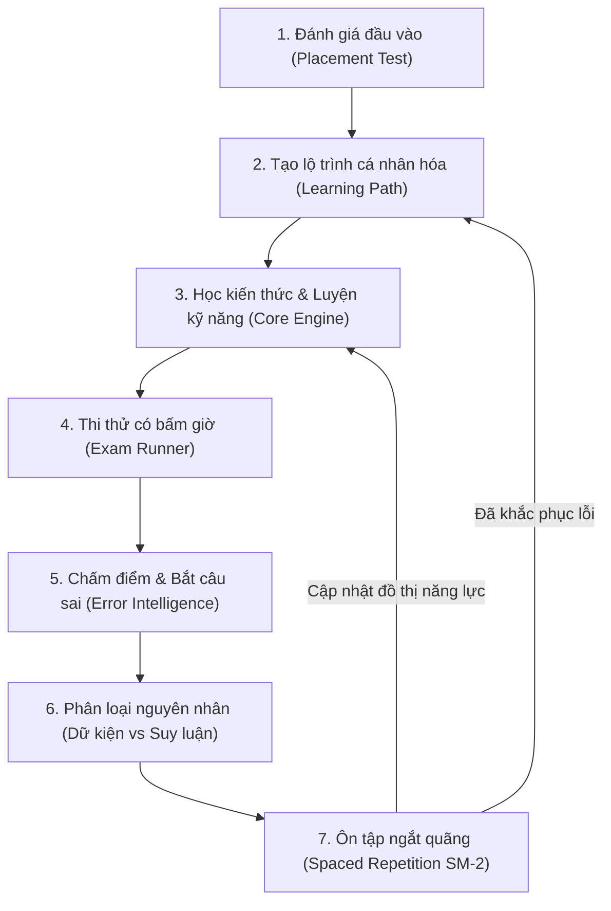
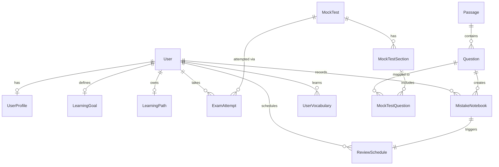

# OrbiLingo — Master Technical Blueprint & Architecture Specification

> **Nền tảng luyện thi tiếng Anh TOEIC–VSTEP thích ứng theo năng lực, tích hợp phân tích lỗi và lộ trình ôn tập cá nhân hóa.**

---

## 1. TỔNG QUAN HỆ THỐNG & VÒNG LẶP SƯ PHẠM KHÉP KÍN

OrbiLingo giải quyết bài toán cốt lõi của người học ngoại ngữ: **"Học vẹt, làm đề xong chỉ biết điểm số mà không biết mình yếu ở đâu, và liên tục lặp lại các lỗi cũ"**. Hệ thống được thiết kế theo mô hình **Closed Adaptive Learning Loop**:

---

## 2. KIẾN TRÚC CÔNG NGHỆ (FULL-STACK STACK)

| Tầng | Công nghệ sử dụng | Vai trò & Trách nhiệm |
| :--- | :--- | :--- |
| **Monorepo** | Turborepo + pnpm workspaces | Quản lý thống nhất `@toeic-vstep/frontend`, `@toeic-vstep/backend`, `@toeic-vstep/shared` |
| **Shared** | TypeScript + Zod | Khai báo Single Source of Truth cho Types, Validation DTO, Thuật toán chấm điểm và SRS |
| **Frontend** | React 18, Vite, TypeScript, TailwindCSS, Zustand, TanStack Query | Giao diện Single Page Application, quản lý state bài thi mượt mà, render audio và passage |
| **Backend** | Node.js, Express, TypeScript, Prisma ORM | Tầng nghiệp vụ, xác thực JWT, phân quyền RBAC, kiểm tra quyền sở hữu resource, chấm điểm bảo mật |
| **Database** | PostgreSQL 16 (Quản lý qua pgAdmin 4) | Cơ sở dữ liệu quan hệ, quan hệ 1-N, N-N, Indexing, Cascade Delete, Json Store cho linh hoạt câu trả lời |

---

## 3. THIẾT KẾ CƠ SỞ DỮ LIỆU CHUẨN HÓA (DATABASE SCHEMA)

Toàn bộ hệ thống được định nghĩa trong `backend/prisma/schema.prisma` với 28 thực thể chia thành 11 nhóm nghiệp vụ:

### Sơ đồ thực thể quan hệ lõi (Core ERD):

---

## 4. BỘ THUẬT TOÁN CỐT LÕI (CORE ALGORITHMIC SPECIFICATION)

### 4.1. Thuật toán quy đổi điểm TOEIC (ETS Piecewise Scaled Score Interpolation)
TOEIC không tính điểm theo công thức `raw * 5`. Điểm số được ánh xạ qua bảng quy đổi phi tuyến (Non-linear raw-to-scaled score map) của ETS:
* Điểm mỗi kỹ năng (Listening, Reading) dao động từ 5 đến 495 (bước nhảy 5 điểm).
* Tổng điểm tối đa: 990.
* Triển khai tại: `packages/shared/src/logic/index.ts` -> hàm `calculateToeicScore(rawL, rawR)`.

### 4.2. Thuật toán tính điểm VSTEP (4 Kỹ năng & Quy chuẩn CEFR)
* Điểm từng kỹ năng $S_{skill} \in [0, 10]$, làm tròn đến 0.5.
* Điểm tổng kết:
  $$\text{FinalScore} = \text{round}\left(\frac{\text{Listening} + \text{Reading} + \text{Writing} + \text{Speaking}}{4} \times 2\right) / 2$$
* Phân bậc chuẩn Bộ GD&ĐT:
  * $< 4.0$: Dưới B1 (Không đạt)
  * $4.0 - 5.5$: Đạt B1
  * $6.0 - 8.0$: Đạt B2
  * $8.5 - 10.0$: Đạt C1

### 4.3. Thuật toán Lặp lại Ngắt quãng (Spaced Repetition SM-2)
Dùng để lên lịch ôn từ vựng và câu hỏi sai:
* Tham số đầu vào: Khoảng cách hiện tại ($I$), Số lần nhớ ($n$), Hệ số ghi nhớ ($EF$, mặc định 2.5), Đánh giá ($q \in [0, 5]$).
* Nếu $q < 3$ (quên hoặc sai):
  $$n = 0, \quad I = 1 \text{ (ngày)}$$
* Nếu $q \ge 3$ (nhớ được):
  $$I(1) = 1, \quad I(2) = 6, \quad I(n) = \text{round}(I(n-1) \times EF)$$
  $$EF' = \max\left(1.3, EF + (0.1 - (5 - q) \times (0.08 + (5 - q) \times 0.02))\right)$$

---

## 5. HỆ THỐNG REUSABLE UI ENGINES (FRONTEND)

Hệ thống đã triển khai sẵn 4 Engine cốt lõi tại `frontend/src/engines/`:
1. **`QuestionRenderer.tsx`**: Render linh hoạt câu hỏi đơn lẻ, câu hỏi có đoạn văn (`Passage`), audio nghe (`Volume2`), hiển thị đáp án và lời giải chi tiết theo thời gian thực.
2. **`ExamRunner.tsx`**: Trình làm bài thi chuẩn phòng thi: Chế độ tập trung (Focus Mode), đếm ngược thời gian toàn bài, ma trận nhảy câu hỏi tức thì (Question Grid Matrix), đánh dấu câu nghi vấn (Bookmark Flag), tự động nộp bài khi hết giờ.
3. **`VocabFlashcardEngine.tsx`**: Lật thẻ 3D tương tác mặt trước / mặt sau, phát âm SpeechSynthesis/Audio, 4 nút đánh giá theo thuật toán SuperMemo SM-2.
4. **`PracticeEngine.tsx`**: Chế độ luyện câu tự do, giải thích ngay lập tức sau khi click, tự động bắt lỗi gửi về backend.

---

## 6. KỊCH BẢN KIỂM THỬ ĐỂ BẢO VỆ ĐỒ ÁN (DEMO SCENARIO)

Khi báo cáo trước hội đồng, bạn trình diễn theo 4 bước khép kín:
1. **Bước 1**: Đăng ký học viên mới -> Thiết lập mục tiêu TOEIC 750 -> Làm bài Placement Test.
2. **Bước 2**: Hệ thống trả về điểm đầu vào 420/990, phân tích điểm yếu ở Part 5 (Thì động từ) & Part 7 (Đọc đoạn văn) -> Tự động sinh `LearningPath`.
3. **Bước 3**: Làm đề thi thử (`/mock-tests`) trên `ExamRunner` -> Học viên chọn sai câu hỏi ngữ pháp -> Nộp bài.
4. **Bước 4**: Mở trang **Sổ tay lỗi sai (`/mistakes`)** -> Xem lại câu vừa làm sai kèm phân loại nguyên nhân -> Chuyển sang **Lịch ôn tập (`/review`)** kiểm chứng thuật toán SM-2 cập nhật thời gian ôn tiếp theo.
